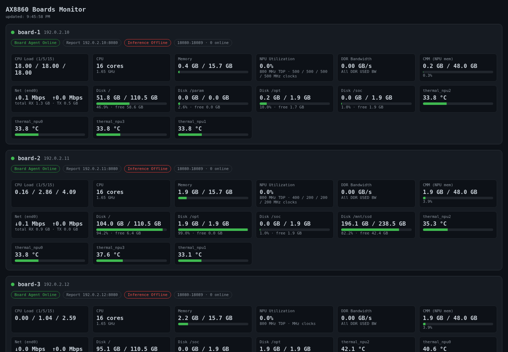

# AXERA tempmon

[](https://github.com/AXERA-TECH/tempmon/actions/workflows/ci.yml)
[](LICENSE)

**tempmon** 是面向 AX8860 / AX8860P 的轻量级板卡状态监控组件：

```text
板端 agent（tempmon.c）
  采集 NPU 温度 / 利用率、CPU、OS 内存、CMM、DDR 带宽、磁盘、网络和 llama-server 状态

中心聚合器（monitor.py）
  轮询多块板卡，发现 llama-server，提供 Web Dashboard 和 JSON API
```

它适合单板调试、多板管理、性能测试采样，以及作为其他工具的只读状态数据源。

> tempmon 只做状态采集，不代理推理请求，也不控制模型启动。模型生命周期管理请使用
> [ax-model-manager](https://github.com/AXERA-TECH/ax-model-manager)。



---

## 架构

```text
Browser / 上位机 / 脚本
        │ HTTP
        ▼
monitor.py 聚合器 :8888
Web Dashboard / JSON API
        │
        │ 轮询 /api/stats
        ▼
板端 tempmon agent :8080
        │
        ▼
OS / CMM / NPU / DDR / network / llama-server
```

默认端口：

| 服务 | 端口 | 说明 |
|---|---:|---|
| tempmon agent | `8080` | 板端只读状态 API |
| monitor aggregator | `8888` | 中心 Web Dashboard 与聚合 API |
| llama-server | `18080–18089` | 被发现和展示的推理端口池 |

---

## 快速上手

### 1. 获取板端 agent

推荐直接下载预编译包：

```text
https://github.com/AXERA-TECH/tempmon/releases
```

下载 `tempmon-<version>-linux-aarch64.tar.gz`，在板端执行：

```bash
tar -xzf tempmon-<version>-linux-aarch64.tar.gz
chmod +x tempmon
./tempmon 8080
```

也可以在板端从源码编译：

```bash
gcc -O2 -s -pthread -o tempmon tempmon.c
./tempmon 8080
```

验证：

```bash
curl http://127.0.0.1:8080/health
curl http://127.0.0.1:8080/api/stats
```

### 2. 启动中心聚合器

在一台可访问板卡的机器上：

```bash
cp boards.example.json boards.json
# 编辑 boards.json，把示例地址换成真实板卡地址
python3 monitor.py
```

打开：

```text
http://<monitor-host>:8888/
```

如果板卡上有 `18080–18089` 之外的服务（例如 axdiffusion 的 `18500`），在 `boards.json`
里显式列出端口：

```json
{
  "name": "board-b",
  "ip": "192.0.2.11",
  "port": 8080,
  "llama_ports": ["18080-18089", 18500]
}
```

`llama_ports` 支持整数或 `"lo-hi"` 区间；不配置时使用默认的 `18080–18089` 扫描范围。

### 3. 生产部署

systemd、主动注册、Bearer token、benchmark 采样等完整说明见：

```text
docs/USER_GUIDE.md
```

---

## 主要功能

- NPU 温度、平均利用率、CPU load / 频率
- OS 内存、CMM 内存池、DDR 带宽、磁盘、网络速率
- llama-server 进程、RSS、监听端口和 slot 状态
- 自动识别 llama-server 与 axdiffusion 生图服务
- 多板卡聚合、Web Dashboard、历史趋势
- 按板卡配置扫描端口（`llama_ports`），支持 18080–18089 之外的服务
- 板卡主动注册，适合 DHCP / IP 变化环境
- 只读 `/api/stats` 与 `/health`
- 可选 Bearer token
- 纯 Python 标准库聚合器，无需 pip 依赖

---

## 指标

| 指标 | 来源 | 字段 |
|---|---|---|
| NPU 温度 | `/sys/class/thermal/thermal_zone*/temp` | `zones[].c` |
| NPU 利用率 | `/proc/ax_proc/npu/top` | `npu.util_avg` |
| CPU | `/proc/stat`、`/proc/cpuinfo` | `cpu_percent`、`cpu_freqs` |
| OS / CMM | `/proc/meminfo`、`/proc/ax_proc/mem_cmm_info` | `mem`、`cmm` |
| DDR 带宽 | `/proc/ax_proc/bw/bw` | `ddr.used_bw_gbps` |
| 网络速率 | `/sys/class/net/end0/statistics` | `net.rx_mbps`、`net.tx_mbps` |
| llama-server / 生图服务 | `/proc` + 端口探测 | `llama`、`inference` |

DDR 带宽说明：agent 启动时如果 `/proc/ax_proc/bw/bw` 不存在，会自动尝试
`insmod /soc/ko/ax_perf_monitor.ko`；读取 `All DDR USED BW`，按 KB × 1024 / 1e9
换算为 GB/s。模块不可用时 `ddr.used_bw_gbps` 返回 `null`。

---

## 文档

- [用户指南](docs/USER_GUIDE.md)：依赖、安装、配置、API、systemd、主动注册、benchmark 采样
- [Agent / 开发指南](docs/skills.md)：项目结构、数据流、API、测试、修改指南、安全规则
- [ax-model-manager](https://github.com/AXERA-TECH/ax-model-manager)：模型生命周期管理
- [LICENSE](LICENSE)

---

## License

MIT License，见 [LICENSE](LICENSE)。
